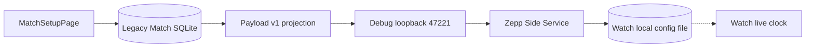

# Mobile Match Preparation — discovery proposal

Status: proposal only. This document does not authorize production code, a schema change, or a hardware claim.

Inspected checkout: `cursor/zepp-live-display-cadence-0e7d` at `902152b`. Unmerged refs were read separately and are not integrated into that checkout. Recorded 28 Nov 2026, Europe/Bucharest.

## 1. Executive Technical Assessment

The phone can create, reopen, and locally store a legacy match, including team names, half length, crew, and optional squads. That store is Drift SQLite (`ref_app_matches`), not Match Memory. Match configuration payload v1 is a projection of that document. It is not a Match Record and it carries no sync acknowledgement.

Watch receipt of that payload exists only as an experimental debug path, and the two halves are not on one branch:

- Phone payload and Android persistence: PR #67, `cursor/forref-mobile-003-android-sync` at `19cab68`. Physical phone persistence was recorded there. Watch transfer was not.
- Phone debug loopback: PR #69, `cursor/forref-mobile-004b-loopback-0e7d` at `973aee4`, stacked on #67. Not an ancestor of the inspected checkout.
- Watch static probe: PR #68, `cursor/forref-mobile-004-zepp-probe-a-0e7d` at `4f25df8`. Bip 6 screen pass for static North/South only.
- Watch phone-payload page: PR #71, `cursor/forref-mobile-004b-watch-bridge-0e7d` at `cd64f18`. Node-tested. Physical transfer not run.
- Display cadence: PR #86 at `902152b`, stacked on #71. Unrelated to configuration. Do not add preparation commits to it.

The stored watch file is not read by Live Match, the official clock, or kick-off. A successful loopback response is not Saved, Reconciled, or MATCH READY. `MatchSyncService` is an empty stub. Mobile Live Officiating remains reachable on the inspected checkout through Match Setup and the match list.

## 2. Current Implementation Inventory

**Create, open, edit, save, recover.** IMPLEMENTED on the inspected checkout and on `origin/main` (`919c906`). Reuse the legacy document.

- Create: `apps/referee_phone/lib/features/matches/matches_page.dart` `newLocalMatch` then `upsertMatch`.
- Defaults: `apps/referee_phone/lib/match/new_match.dart`. Status `setup`, local date, empty names, half length 2700 seconds.
- Edit and save: `apps/referee_phone/lib/features/match_setup/match_setup_page.dart` `_persistSetup` writes the legacy `Match` through `MatchSession.replace` when the user continues, and when a player is added. Text fields are not written on every keystroke.
- Recover: Drift `getMatch` / `listNewestFirst`. Test: `apps/referee_phone/test/infrastructure/local_match_database_test.dart`.
- Stored today: match id, date, competition, venue, home and away ids and names, half length, crew names, squad `Player` rows (`playerId` from `clientId()`, shirt number, name).
- Absent from the legacy `Team` model and from setup: abbreviations, kit colors, a separate kick-off clock time.

**Required versus optional.** EXPERIMENTAL, and the success claim conflicts with the officiating hold. `apps/referee_phone/lib/officiate/preparation_assessment.dart` exists only at `19cab68` / `973aee4`. Required there: home name, away name, half length, local storage, known recording authority. Optional: competition, venue, crew, squad names. The positive claim is `readyToOfficiateOnThisPhone`, and `canEnterLiveMatch` opens the phone live path. Do not reuse that claim unchanged.

**Payload v1.** EXPERIMENTAL. Not on the inspected checkout. `apps/referee_phone/lib/officiate/match_configuration_payload.dart` at `973aee4`. Version 1 fields: `payloadVersion`, `matchId`, `updatedAt`, `date`, competition, venue, home and away ids and names, `halfDurationSeconds`, `extraTimeEnabled`, `extraTimeHalfDurationSeconds`, four crew name strings. Omitted: score, events, status, sync, squads, abbreviations, kit colors, competition-rules JSON. Tests: `match_configuration_payload_test.dart` on #67 and #69. Reuse this contract. Do not add fields without a reviewed version.

**Competition rules.** IMPLEMENTED beside Match Memory, not inside the payload. `apps/referee_phone/lib/infrastructure/competition_rules/match_competition_rules_store.dart` writes `forref_match_competition_rules.json`. Setup on the inspected checkout persists half length into the legacy match. Extra-time settings on that match are not bound by the setup screen, so a later payload can still say extra time is off.

**Squads and participant identity.** Legacy squads IMPLEMENTED. Authoritative participants PLANNED. Phone setup never calls `commitParticipantTeamBinding`. `MatchParticipantId` is an opaque token in `packages/forref_match_core/lib/match_participant.dart`. Shirt number and display name are not that id. A squad row in the legacy match is not a team binding.

**Phone to watch transport.** EXPERIMENTAL and split. Phone: `LocalConfigurationBridge` at `973aee4`, debug-only, `kDebugMode`, `127.0.0.1:47221`, `GET /match-configuration`, re-reads SQLite per request, 404 `{"disposition":"missing"}` with no team names. Tests: `local_configuration_bridge_test.dart`. Watch: `apps/forref_watch_zepp/utils/local_bridge.js` and `apps/forref_watch_zepp/page/gt/local/index.page.js` at `cd64f18`, still present at `902152b`. Side service fetches that URL with a 4 second timeout and stores `forref_local_bridge_config.json` only after validation and readback. A failed fetch does not overwrite a stored phone payload. Tests: `local_bridge.test.js`. Evidence: `docs/forref-execution/evidence/zepp-local-bridge/BRIDGE.md` says the physical checklist has not been run.

**Probe A.** IMPLEMENTED and physically seen. Static North/South in `apps/forref_watch_zepp/utils/config_probe.js`, file `forref_probe_a_config.json`. `docs/forref-execution/evidence/zepp-probe-a/PROBE_A.md` records the Bip 6 screen on 21 Nov 2026. The phone path rejects `probe-a-static`. Probe A does not prove a Flutter match moved.

**Device choice and compatibility.** PLANNED. `devices_page.dart` exists only on `19cab68` and renders an empty companion from the mobile-command model. No Zepp allow-list, no pairing control. The watch logs `deviceSource` and does not gate on it. `app.json` targets round and square.

**Watch officiating use of the configuration.** PLANNED. Live labels are generic home and away strings. `halfDurationSeconds` from the file is not applied to `apps/forref_watch_zepp/utils/match_clock.js`. Clock phase `READY` is a stopped clock, not architecture Match Ready, and it does not require the configuration file.

**Production sync.** PLANNED. `apps/referee_phone/lib/infrastructure/sync/match_sync_service.dart` has no behavior and no callers.

**Mobile live entry.** IMPLEMENTED and still exposed. Setup continues into `/live`. The match list opens `/live` for a match that is no longer in setup. Preserve the page. Do not add controls.

## 3. Gap and Dependency Matrix

- **User interface.** Current setup has no transfer action, no destination device, and no honest local-only versus watch-stored state. The experimental preparation screen claims the phone can officiate. Setup still offers the live match. Abbreviations, kit colors, and kick-off time have no fields.
- **Domain and model.** Payload v1 cannot carry squads, abbreviations, kit colors, kick-off time, or the competition-rules sidecar. Those need a new version and contract review. Legacy `Player.playerId` is not `MatchParticipantId`. Extra time in the payload can disagree with the rules file because setup does not write `extraTimeEnabled`.
- **Persistence.** Legacy match recovery exists. Watch file readback exists for the experimental payload. Nothing records a durable watch-accepted version on the phone. Match Memory has no configuration record type. Do not invent one in the first slices.
- **Transport.** The only implemented path is debug loopback plus Zepp Side Service fetch. It is not production, not certified, and the phone server is absent from the watch branch. There is no retry protocol beyond fetching again and replacing the file when validation passes.
- **Watch runtime.** The official match still starts from an empty clock session. Stored names and half length are display-only on the PHONE CONFIG page.
- **Hardware certification.** Probe A screen: pass. Phone SQLite persistence on #67: pass for the legacy document. Phone-to-watch payload: not run. Offline watch use of that payload: not run. Zepp fetch of `127.0.0.1` may still fail on device; that result is unknown, not a pass.

## 4. Proposed Architecture

Keep these boundaries:

- Legacy `Match` in Drift remains the phone’s configuration document.
- `MatchConfigurationPayload` v1 remains a read-only projection of that document. It is not a commit and not an acknowledgement.
- Match Memory stays the only place sporting records are committed, and this workflow does not write it.
- One writable Match Authority. Preparation must not also commit a second configuration history.
- Watch file `forref_local_bridge_config.json` remains a local copy of v1. Presence of the file is not MATCH READY and not Saved.
- Probe A stays a separate static file and page.
- The debug loopback stays debug-only until a Founder decision promotes a different transport. A 200 response stays “served,” never Saved or Reconciled.

The dotted line is the missing read. It stays unwired until the transfer itself has a hardware result and the Founder allows the clock to take half length and names from that file.

Changed configuration: the phone re-reads SQLite on each request, so the next successful watch store replaces the file. The watch already refuses to clear a good file when the fetch fails. The phone has no record of which `updatedAt` the watch stored.

## 5. Proposed Implementation Stages

Each stage is a separate change. Do not rebase #67, #68, #69, #71, or #86.

**Stage 0 — Certify the bridge that already exists.** No new schema and no clock edit. Install the phone from `973aee4` and the watch package `1.0.13` or `1.0.14`. Start the debug server, open PHONE CONFIG, then close the phone app and reopen the watch page.

- Owner: existing loopback and `apps/forref_watch_zepp/utils/local_bridge.js`.
- Automated: the suites already on those commits. Re-run them; do not treat that as the device result.
- Physical pass: the watch shows the phone’s team names, a second edit replaces them, a failed fetch keeps the previous names, and the names remain after the phone app is gone.
- Fail: the watch shows North/South, blank names after a good save, or a phone acknowledgement that the watch stored the file.
- Blocked: Zepp fetch cannot reach `127.0.0.1`, or the two packages cannot be installed together. Record the blocker. Do not replace the transport inside this stage.

**Stage 1 — Phone preparation claim for transfer, after Stage 0 has a result.** New branch from `973aee4`. Change the experimental assessment so the positive claim is “saved locally and eligible to send,” with blockers limited to missing home name, away name, or half length. Competition, venue, crew, and squads stay optional and non-blocking. Remove `readyToOfficiateOnThisPhone` from the success path. Leave the Live Match page in the tree and do not add kick-off or event controls.

- Tests: assessment cases for missing required names, blank optional venue, and restart reload of the same legacy match.
- Physical: create a match, leave the app, reopen it, and see the same names. The screen must not say the phone is ready to officiate.
- Pass: required gaps block eligibility; optional gaps do not; the match reloads.
- Fail: eligibility without both team names, or a new write into Match Memory.

**Stage 2 — Watch displays the stored copy during officiating, only if Stage 0 passed and the Founder allows the clock to read the file.** New branch from `902152b`. The live page may show stored team names. Half length is applied only as the existing session limit field, using the payload number, and elapsed time remains closed time plus `device UTC − openStartUtc`. File absence keeps the current generic labels and the current default limit. No network call on that page.

- Tests: a stored v1 body supplies names and limit; a missing file does not invent names; a paint still does not add a second.
- Physical: airplane mode, stored names visible, clock still advances from the anchor.
- Pass: names match the file and the elapsed formula is unchanged.
- Fail: the clock moves because the file was read, or a missing file is reported as transferred.

**Stage 3 — Payload version review, only after the Founder lists the extra fields.** Candidates that v1 cannot carry: squads, abbreviations, kit colors, kick-off time, competition-rules sidecar. This stage does not start until the field list is approved. Participant bindings stay out of it unless the Founder asks for authoritative squads.

Later transport replacement, device picker, and Watch to Mobile record replication are separate missions. They are outside this preparation slice.

## 6. Risk Register

- Calling loopback success Saved or MATCH READY would be a false acknowledgement. The phone cannot see the watch file.
- Writing preparation into Match Memory would create a second writer next to the legacy document.
- `readyToOfficiateOnThisPhone` contradicts the live-officiating hold if it is merged as-is.
- Putting phone loopback and watch changes on one branch, or committing them onto #86, mixes hardware gates.
- Applying `halfDurationSeconds` by incrementing the clock, or by treating the file as temporal authority, corrupts official elapsed time.
- A payload built from current setup can report extra time off while the rules sidecar says otherwise.
- Promoting the debug port to a production sync state is prohibited. `MatchSyncService` must stay empty in these stages.
- Stage 0 can fail because the watch and the phone are different devices. `127.0.0.1` on the watch is the watch, not the phone. That risk is why Stage 0 is first.

## 7. Human Decisions Required

1. **First authorized slice.** Alternative A: Stage 0 hardware only. Alternative B: Stage 1 phone claim first. Recommendation: A. Postponing A leaves every later stage uncertified. Alternative B can proceed in parallel only as phone-local work that does not claim a watch result.
2. **MATCH READY for this journey.** Alternative A: watch file passed v1 validation and readback, phone still not told. Alternative B: clock phase READY. Alternative C: Match Memory admission after a generation-one root. Recommendation: A for “configuration is on the watch,” and keep B and C as different states with different names. Postponing this lets the UI collapse three meanings into one word.
3. **Whether the watch clock may read half length and names from the file.** Alternative A: names only. Alternative B: names and `halfDurationSeconds` as the session limit, elapsed formula unchanged. Alternative C: leave the file on the PHONE CONFIG page only. Recommendation: C until Stage 0 passes, then B. Postponing B keeps officiating on generic labels, which is safe.
4. **Setup entry to phone Live Match.** Alternative A: leave the existing button. Alternative B: stop offering it from setup and the match list while keeping the page and routes. Recommendation: B when Stage 1 is approved, because the hold says not to expose phone officiating. Postponing B leaves kick-off one tap away.
5. **Fields beyond v1.** Alternatives: ship v1 only; or approve a v2 field list before any schema edit. Recommendation: ship v1 only until Stage 0 and Stage 1 are accepted. Abbreviations, kit colors, kick-off time, and squads are not in the current contract. Postponing v2 does not block transfer of the fields v1 already has.
6. **Authoritative squads.** Alternative A: squads remain legacy optional rows and stay out of the payload. Alternative B: map each player to `MatchParticipantId` and commit one team binding through the existing D1 port. Recommendation: A until a Founder asks for watch-side player identity. Postponing B means the watch cannot name a participant from the phone squad.
7. **Production transport after the loopback result.** If Stage 0 is blocked, the alternatives are a phone-reachable address the watch can fetch, or a Zepp message that carries the same v1 JSON. Recommendation: do not choose until Stage 0 records the actual failure. The payload body should stay v1 either way.

`docs/open-decisions.md` still blocks visual design and Firebase project ids. This proposal does not need either.

## 8. Recommended First Implementation Slice

Stage 0 only. No branch, no schema, no Match Core edit, no clock edit, no new acknowledgement.

Use the phone build at `973aee4` and the watch build at `cd64f18` or `902152b`. Confirm the watch shows the saved team names, keeps them when the phone is closed, and does not show the static Probe A fixture. The result is PASS, FAIL, or BLOCKED with the console and the screen. That result decides whether Stage 1 and Stage 2 are worth writing.
