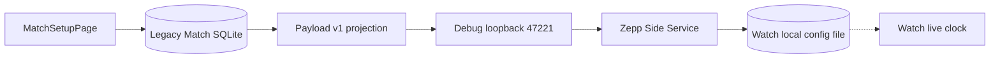
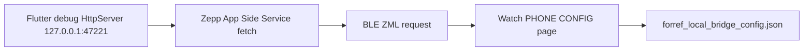

# Mobile Match Preparation — negotiation

Status: **PROPOSED. Not implementation approval.**

Negotiation artifact: `docs/forref-execution/MOBILE_MATCH_PREPARATION.md`.

Publication is recorded in section 13 after the pull request exists. Sections 1–8 are the original discovery. Section 9 is the Founder review of 28 Nov 2026. Section 10 onward is Negotiation Round 2 and does not replace those sections.

Source of the Founder amendments: Google Doc `1ZYJFwGi8cCJ2SXwQkqNKPPPVNSBRGn11`, read 28 Nov 2026.

---

## 1. Executive Technical Assessment

The phone can create, reopen, and locally store a legacy match, including team names, half length, crew, and optional squads. That store is Drift SQLite (`ref_app_matches`), not Match Memory. Match configuration payload v1 is a projection of that document. It is not a Match Record and it carries no sync acknowledgement.

Watch receipt of that payload exists only as an experimental debug path, and the two halves are not on one branch:

- Phone payload and Android persistence: PR #67, `cursor/forref-mobile-003-android-sync` at `19cab68`. Physical phone persistence was recorded there. Watch transfer was not.
- Phone debug loopback: PR #69, `cursor/forref-mobile-004b-loopback-0e7d` at `973aee4`, stacked on #67. Not an ancestor of the checkout inspected for the discovery (`902152b`).
- Watch static probe: PR #68, `cursor/forref-mobile-004-zepp-probe-a-0e7d` at `4f25df8`. Bip 6 screen pass for static North/South only.
- Watch phone-payload page: PR #71, `cursor/forref-mobile-004b-watch-bridge-0e7d` at `cd64f18`. Node-tested. Physical transfer not run.
- Display cadence: PR #86 at `902152b`, stacked on #71. Unrelated to configuration. Do not add preparation commits to it.

The stored watch file is not read by Live Match, the official clock, or kick-off. A successful loopback response is not Saved, Reconciled, or MATCH READY. `MatchSyncService` is an empty stub. Mobile Live Officiating remains reachable on the inspected checkout through Match Setup and the match list.

## 2. Current Implementation Inventory

**Create, open, edit, save, recover.** IMPLEMENTED on the inspected checkout and on `origin/main` (`919c906`). Reuse the legacy document.

- Create: `apps/referee_phone/lib/features/matches/matches_page.dart` `newLocalMatch` then `upsertMatch`.
- Defaults: `apps/referee_phone/lib/match/new_match.dart`. Status `setup`, local date, empty names, half length 2700 seconds.
- Edit and save: `apps/referee_phone/lib/features/match_setup/match_setup_page.dart` `_persistSetup` writes the legacy `Match` through `MatchSession.replace` when the user continues, and when a player is added. Text fields are not written on every keystroke.
- Recover: Drift `getMatch` / `listNewestFirst`. Test: `apps/referee_phone/test/infrastructure/local_match_database_test.dart`.
- Stored today: match id, date, competition, venue, home and away ids and names, half length, crew names, squad `Player` rows (`playerId` from `clientId()`, shirt number, name).
- Absent from the legacy `Team` model and from setup: abbreviations, kit colors, a separate kick-off clock time.

**Required versus optional.** EXPERIMENTAL, and the success claim conflicts with the officiating hold. `apps/referee_phone/lib/officiate/preparation_assessment.dart` exists only at `19cab68` / `973aee4`. Required there: home name, away name, half length, local storage, known recording authority. Optional: competition, venue, crew, squad names. The positive claim is `readyToOfficiateOnThisPhone`, and `canEnterLiveMatch` opens the phone live path. Do not reuse that claim unchanged.

**Payload v1.** EXPERIMENTAL. Not on `origin/main`. `apps/referee_phone/lib/officiate/match_configuration_payload.dart` at `973aee4`. Version 1 fields: `payloadVersion`, `matchId`, `updatedAt`, `date`, competition, venue, home and away ids and names, `halfDurationSeconds`, `extraTimeEnabled`, `extraTimeHalfDurationSeconds`, four crew name strings. Omitted: score, events, status, sync, squads, abbreviations, kit colors, competition-rules JSON. Tests: `match_configuration_payload_test.dart` on #67 and #69. Reuse this contract. Do not add fields without a reviewed version.

**Competition rules.** IMPLEMENTED beside Match Memory, not inside the payload. `apps/referee_phone/lib/infrastructure/competition_rules/match_competition_rules_store.dart` writes `forref_match_competition_rules.json`. Setup persists half length into the legacy match. Extra-time settings on that match are not bound by the setup screen, so a later payload can still say extra time is off.

**Squads and participant identity.** Legacy squads IMPLEMENTED. Authoritative participants PLANNED. Phone setup never calls `commitParticipantTeamBinding`. `MatchParticipantId` is an opaque token in `packages/forref_match_core/lib/match_participant.dart`. Shirt number and display name are not that id. A squad row in the legacy match is not a team binding.

**Phone to watch transport.** EXPERIMENTAL and split. Phone: `LocalConfigurationBridge` at `973aee4`, debug-only, `kDebugMode`, `127.0.0.1:47221`, `GET /match-configuration`, re-reads SQLite per request, 404 `{"disposition":"missing"}` with no team names. Tests: `local_configuration_bridge_test.dart`. Watch: `apps/forref_watch_zepp/utils/local_bridge.js` and `apps/forref_watch_zepp/page/gt/local/index.page.js` at `cd64f18`. Side service fetches that URL with a 4 second timeout and stores `forref_local_bridge_config.json` only after validation and readback. A failed fetch does not overwrite a stored phone payload. Tests: `local_bridge.test.js`. Evidence: `docs/forref-execution/evidence/zepp-local-bridge/BRIDGE.md` says the physical checklist has not been run.

**Probe A.** IMPLEMENTED and physically seen. Static North/South in `apps/forref_watch_zepp/utils/config_probe.js`, file `forref_probe_a_config.json`. `docs/forref-execution/evidence/zepp-probe-a/PROBE_A.md` records the Bip 6 screen on 21 Nov 2026. The phone path rejects `probe-a-static`. Probe A does not prove a Flutter match moved.

**Device choice and compatibility.** PLANNED. `devices_page.dart` exists only on `19cab68` and renders an empty companion from the mobile-command model. No Zepp allow-list, no pairing control. The watch logs `deviceSource` and does not gate on it. `app.json` targets round and square.

**Watch officiating use of the configuration.** PLANNED. Live labels are generic home and away strings. `halfDurationSeconds` from the file is not applied to `apps/forref_watch_zepp/utils/match_clock.js`. Clock phase `READY` is a stopped clock, not architecture Match Ready, and it does not require the configuration file.

**Production sync.** PLANNED. `apps/referee_phone/lib/infrastructure/sync/match_sync_service.dart` has no behavior and no callers.

**Mobile live entry.** IMPLEMENTED and still exposed. Setup continues into `/live`. The match list opens `/live` for a match that is no longer in setup. Preserve the page. Do not add controls.

## 3. Gap and Dependency Matrix

- **User interface.** Current setup has no transfer action, no destination device, and no honest local-only versus watch-stored state. The experimental preparation screen claims the phone can officiate. Setup still offers the live match. Abbreviations, kit colors, and kick-off time have no fields.
- **Domain and model.** Payload v1 cannot carry squads, abbreviations, kit colors, kick-off time, or the competition-rules sidecar. Those need a new version and contract review. Legacy `Player.playerId` is not `MatchParticipantId`. Extra time in the payload can disagree with the rules file because setup does not write `extraTimeEnabled`.
- **Persistence.** Legacy match recovery exists. Watch file readback exists for the experimental payload. Nothing records a durable watch-accepted version on the phone. Match Memory has no configuration record type. Do not invent one in the first slices.
- **Transport.** The only implemented path is debug loopback plus Zepp Side Service fetch. It is not production, not certified, and the phone server is absent from the watch branch. There is no retry protocol beyond fetching again and replacing the file when validation passes.
- **Watch runtime.** The official match still starts from an empty clock session. Stored names and half length are display-only on the PHONE CONFIG page.
- **Hardware certification.** Probe A screen: pass. Phone SQLite persistence on #67: pass for the legacy document. Phone-to-watch payload: not run. Offline watch use of that payload: not run.

## 4. Proposed Architecture

Keep these boundaries:

- Legacy `Match` in Drift remains the phone’s configuration document.
- `MatchConfigurationPayload` v1 remains a read-only projection of that document. It is not a commit and not an acknowledgement.
- Match Memory stays the only place sporting records are committed, and this workflow does not write it.
- One writable Match Authority. Preparation must not also commit a second configuration history.
- Watch file `forref_local_bridge_config.json` remains a local copy of v1. Presence of the file is not MATCH READY and not Saved.
- Probe A stays a separate static file and page.
- The debug loopback stays debug-only until a Founder decision promotes a different transport. A 200 response stays “served,” never Saved or Reconciled.



The dotted line is the missing read. It stays unwired until the transfer itself has a hardware result and the Founder allows the clock to take half length and names from that file.

Changed configuration: the phone re-reads SQLite on each request, so the next successful watch store replaces the file. The watch already refuses to clear a good file when the fetch fails. The phone has no record of which `updatedAt` the watch stored.

## 5. Proposed Implementation Stages

Each stage is a separate change. Do not rebase #67, #68, #69, #71, or #86.

**Stage 0 — Certify the bridge that already exists.** No new schema and no clock edit. Install the phone from `973aee4` and the watch package `1.0.13` or `1.0.14`. Start the debug server, open PHONE CONFIG, then close the phone app and reopen the watch page.

- Owner: existing loopback and `apps/forref_watch_zepp/utils/local_bridge.js`.
- Automated: the suites already on those commits. Re-run them; do not treat that as the device result.
- Physical pass: the watch shows the phone’s team names, a second edit replaces them, a failed fetch keeps the previous names, and the names remain after the phone app is gone.
- Fail: the watch shows North/South, blank names after a good save, or a phone acknowledgement that the watch stored the file.
- Blocked: Zepp fetch cannot reach `127.0.0.1`, or the two packages cannot be installed together. Record the blocker. Do not replace the transport inside this stage.

**Stage 1 — Phone preparation claim for transfer, after Stage 0 has a result.** New branch from `973aee4`. Change the experimental assessment so the positive claim is “saved locally and eligible to send,” with blockers limited to missing home name, away name, or half length. Competition, venue, crew, and squads stay optional and non-blocking. Remove `readyToOfficiateOnThisPhone` from the success path. Leave the Live Match page in the tree and do not add kick-off or event controls.

- Tests: assessment cases for missing required names, blank optional venue, and restart reload of the same legacy match.
- Physical: create a match, leave the app, reopen it, and see the same names. The screen must not say the phone is ready to officiate.
- Pass: required gaps block eligibility; optional gaps do not; the match reloads.
- Fail: eligibility without both team names, or a new write into Match Memory.

**Stage 2 — Watch displays the stored copy during officiating, only if Stage 0 passed and the Founder allows the clock to read the file.** New branch from `902152b`. The live page may show stored team names. Half length is applied only as the existing session limit field, using the payload number, and elapsed time remains closed time plus `device UTC − openStartUtc`. File absence keeps the current generic labels and the current default limit. No network call on that page.

- Tests: a stored v1 body supplies names and limit; a missing file does not invent names; a paint still does not add a second.
- Physical: airplane mode, stored names visible, clock still advances from the anchor.
- Pass: names match the file and the elapsed formula is unchanged.
- Fail: the clock moves because the file was read, or a missing file is reported as transferred.

**Stage 3 — Payload version review, only after the Founder lists the extra fields.** Candidates that v1 cannot carry: squads, abbreviations, kit colors, kick-off time, competition-rules sidecar. This stage does not start until the field list is approved. Participant bindings stay out of it unless the Founder asks for authoritative squads.

Later transport replacement, device picker, and Watch to Mobile record replication are separate missions. They are outside this preparation slice.

## 6. Risk Register

- Calling loopback success Saved or MATCH READY would be a false acknowledgement. The phone cannot see the watch file.
- Writing preparation into Match Memory would create a second writer next to the legacy document.
- `readyToOfficiateOnThisPhone` contradicts the live-officiating hold if it is merged as-is.
- Putting phone loopback and watch changes on one branch, or committing them onto #86, mixes hardware gates.
- Applying `halfDurationSeconds` by incrementing the clock, or by treating the file as temporal authority, corrupts official elapsed time.
- A payload built from current setup can report extra time off while the rules sidecar says otherwise.
- Promoting the debug port to a production sync state is prohibited. `MatchSyncService` must stay empty in these stages.
- Stage 0 can fail because the watch and the phone are different devices. `127.0.0.1` on the watch is the watch, not the phone. That risk is why Stage 0 is first.

## 7. Human Decisions Required

1. **First authorized slice.** Alternative A: Stage 0 hardware only. Alternative B: Stage 1 phone claim first. Recommendation: A. Postponing A leaves every later stage uncertified. Alternative B can proceed in parallel only as phone-local work that does not claim a watch result.
2. **MATCH READY for this journey.** Alternative A: watch file passed v1 validation and readback, phone still not told. Alternative B: clock phase READY. Alternative C: Match Memory admission after a generation-one root. Recommendation: A for “configuration is on the watch,” and keep B and C as different states with different names. Postponing this lets the UI collapse three meanings into one word.
3. **Whether the watch clock may read half length and names from the file.** Alternative A: names only. Alternative B: names and `halfDurationSeconds` as the session limit, elapsed formula unchanged. Alternative C: leave the file on the PHONE CONFIG page only. Recommendation: C until Stage 0 passes, then B. Postponing B keeps officiating on generic labels, which is safe.
4. **Setup entry to phone Live Match.** Alternative A: leave the existing button. Alternative B: stop offering it from setup and the match list while keeping the page and routes. Recommendation: B when Stage 1 is approved, because the hold says not to expose phone officiating. Postponing B leaves kick-off one tap away.
5. **Fields beyond v1.** Alternatives: ship v1 only; or approve a v2 field list before any schema edit. Recommendation: ship v1 only until Stage 0 and Stage 1 are accepted. Abbreviations, kit colors, kick-off time, and squads are not in the current contract. Postponing v2 does not block transfer of the fields v1 already has.
6. **Authoritative squads.** Alternative A: squads remain legacy optional rows and stay out of the payload. Alternative B: map each player to `MatchParticipantId` and commit one team binding through the existing D1 port. Recommendation: A until a Founder asks for watch-side player identity. Postponing B means the watch cannot name a participant from the phone squad.
7. **Production transport after the loopback result.** If Stage 0 is blocked, the alternatives are a phone-reachable address the watch can fetch, or a Zepp message that carries the same v1 JSON. Recommendation: do not choose until Stage 0 records the actual failure. The payload body should stay v1 either way.

`docs/open-decisions.md` still blocks visual design and Firebase project ids. This proposal does not need either.

## 8. Recommended First Implementation Slice

Stage 0 only. No branch, no schema, no Match Core edit, no clock edit, no new acknowledgement.

Use the phone build at `973aee4` and the watch build at `cd64f18` or `902152b`. Confirm the watch shows the saved team names, keeps them when the phone is closed, and does not show the static Probe A fixture. The result is PASS, FAIL, or BLOCKED with the console and the screen. That result decides whether Stage 1 and Stage 2 are worth writing.

Section 8 is superseded for sequencing by section 12. It remains here so the original recommendation stays traceable.

---

## 9. Founder Architecture Review — Negotiation Round 1 (28 Nov 2026)

**Status: REVIEW REQUIRED — NOT IMPLEMENTATION APPROVAL.** Sections 1–8 above are the original Cursor discovery proposal and must remain traceable. This review does not authorize implementation, schema edits, hardware claims, merges, visual work, or changes to the open hardware-gate branches.

### 9.1 Accepted premises (FROZEN)

- FORREF is smartwatch-first. Mobile creates, edits, saves and transfers configurations; **Mobile Live Officiating remains ON HOLD**. Keep the existing code, but do not expose live officiating controls in the release navigation.
- The Drift legacy Match is a mobile configuration document, not a second authority for sporting Match Records. The watch must officiate autonomously and offline after an actually verified setup.
- Payload v1 and its debug transport are experimental. Local phone save, HTTP 200, file readback, Match Core admission, and readiness to officiate are different states.
- Respect frozen Match Core, D1, immutable event and temporal contracts. Figma and visual redesign stay ON HOLD. Do not mix this planning PR with #67/#68/#69/#71/#86 implementation branches.

### 9.2 Required revisions (MP-01 to MP-07)

**MP-01 — Prove or disprove transport topology [BLOCKER].** Stage 0 relies on a Side Service fetch of `127.0.0.1:47221`. The loopback address resolves within the requesting device/runtime, not automatically to the Android phone. Document exact process and network topology: Flutter listener, Android/Zepp companion, Zepp Side Service host, BLE/ZML path, and watch file storage. Identify where `fetch` executes and what API provides routing. Reference actual source/Zepp SDK evidence. If unreachable, mark **BLOCKED: TRANSPORT TOPOLOGY**, and compare supported alternatives without choosing one or inventing an endpoint. A physical checklist must not be used to repeatedly test a topology proven impossible.

**MP-02 — Phone Live Officiating hold is independent [MUST FIX PLAN].** The proposal incorrectly delays hiding `/live` entry until Stage 1 after successful Stage 0. No transfer or watch result is required to enforce the Founder scope. Propose a separate minimal reversible `MOBILE-LIVE-ENTRY-HOLD` slice that prevents access from Setup, Matches, deep links, secondary actions and back-navigation. Preserve dormant code. Specify source files, exact behavior, navigation tests and rollback. This is planning only; no code now.

**MP-03 — Define configuration truth [HUMAN GATE].** Propose distinct evidence-based states for `LOCAL_SAVED`, `TRANSFER_ATTEMPTED`, `WATCH_RECEIVED`, `WATCH_VALIDATED`, `WATCH_DURABLY_STORED`, `WATCH_OFFLINE_AVAILABLE`, and `READY_FOR_OFFICIATING` (only after the relevant watch/core readiness contract is satisfied). Split watch-observed truth from what the phone can actually verify via an explicit acknowledgement. File presence or readback does not alone prove autonomous clock/event capture readiness. Define unknown, retry, error, and stale-data behavior. Do not invent authoritative Match Records or claim production synchronization.

**MP-04 — Configuration revision and update safety [HUMAN GATE].** Analyze stable `matchId`, monotonic revision or content fingerprint, payload schema version vs match configuration revision, same-match update, cross-match replacement, invalid/partial payload, replay, duplicates, out-of-order/stale packages and already-started watch matches. Evaluate if `updatedAt` alone is safe under clock skew. Explain whether watch v1 storage is single-match or multi-match, with source evidence. Do not modify v1 until approved.

**MP-05 — Field/semantics decision matrix [HUMAN GATE].** For each of home/away names and stable IDs, date, kickoff time/time zone, half duration, competition, venue, crew, extra-time rule, squads, player identity/team binding, abbreviations and kit colors, show: phone persistence, presence in v1, watch persistence, actual watch runtime consumption, requiredness for local save / transfer / officiating, and outstanding decisions. Explicitly reconcile extra-time settings vs rules sidecar. Optional squads must not silently override player-specific event admission rules.

**MP-06 — Small, independently certified slices [MUST FIX PLAN].** Replace a single chain with gates G0–G5. `G1` and `G2` must not wait for `G3`. Negative tests must include unavailable phone, disconnection/timeout, duplicate retries, partial/corrupt packet, wrong-match or stale configuration, process restart, and lost acknowledgement. Report software PASS separately from real-device PASS.

**MP-07 — Branch and governance discipline [MUST FIX PLAN].** This negotiation is documents-only. Any future implementation baseline must be selected by verified branch ancestry and current hardware gates, not by convenience. Do not implement Match Preparation on PR #86. `AGENTS.md` still states a phone-first legacy goal; record the explicit Founder watch-first/current-release exception in this plan and identify a later governance update as a separate approval item. Configuration transfer does not include future Watch→Mobile immutable Match Record replication.

### 9.3 Founder disposition of the original stages

| Original proposal | Decision | Required adjustment |
| --- | --- | --- |
| Stage 0 bridge hardware test first | CONDITIONAL | G0 topology evidence precedes assuming direct loopback can work. |
| Stage 1 local preparation readiness | ACCEPT IN PRINCIPLE | Separate local save and Live entry containment from bridge success. |
| Stage 2 watch uses names and half duration | DEFER | Require transfer evidence, read/validation, offline and clock non-regression tests. |
| Stage 3 payload v2 review | ACCEPT AS REVIEW | Field matrix, versioning and stale-data policy require Founder sign-off. |
| Keep existing mobile Live entry until Stage 1 | REJECT | Current-release scope containment is an independent gate. |
| Call file validation/readback MATCH READY | REJECT AS EQUIVALENCE | `WATCH_CONFIG_STORED` is not `READY_FOR_OFFICIATING`. |
| Postpone all authoritative squads | CONDITIONAL | Setup squads may be optional; watch player-event admission still needs a precise contract. |

---

## 10. Negotiation Round 2 — responses to MP-01–MP-07

Recorded 28 Nov 2026, Europe/Bucharest. Every new choice below is **PROPOSED**.

### MP-01 — COUNTERPROPOSE the watch-loopback failure, and BLOCKED on the last hop

**COUNTERPROPOSE.** The watch Device App does not open `127.0.0.1:47221`. Section 6 of the original proposal treated that address as the watch’s loopback. The source does not do that.

Verified path:

1. Flutter debug listener, commit `973aee4`, `apps/referee_phone/lib/officiate/local_configuration_bridge.dart`. `HttpServer.bind(InternetAddress.loopbackIPv4, 47221)` accepts only `127.0.0.1`. The server exists only when `kDebugMode` is true. It re-reads the legacy match per `GET /match-configuration`. It does not bind any other interface.
2. Zepp Side Service, commit `cd64f18`, `apps/forref_watch_zepp/app-side/index.js`. `onRequest` calls `this.fetch` with `LOCAL_BRIDGE_URL` from `apps/forref_watch_zepp/utils/local_bridge.js` (`http://127.0.0.1:47221/match-configuration`, timeout 4000 ms). That file is the Side Service entry, not a watch page.
3. Watch Device App, `apps/forref_watch_zepp/page/gt/local/index.page.js`. It calls `this.request({ method: GET_LOCAL_CONFIGURATION })` from `@zeppos/zml/base-page`. After a valid body it writes `forref_local_bridge_config.json` through `@zos/fs` and reads it back in `storeRecord`.
4. Routing API. Zepp OS documentation, Overall Architecture, states that the Side Service runs in the Zepp App on the mobile device, that BLE between Device App and Side Service is exposed as ZML `this.request` / `onRequest`, and that the Side Service talks to an external server through the Fetch API. Probe A on the Bip 6 (`docs/forref-execution/evidence/zepp-probe-a/PROBE_A.md`, 21 Nov 2026) showed that ZML request/response path working for a body compiled into the Side Service. It did not exercise Fetch.
5. `docs/forref-execution/evidence/zepp-probe-a/PROBE_B.md` already records the same split: the Side Service cannot read the Flutter SQLite file, and Fetch is the only documented call that leaves the Zepp app. It marks loopback Fetch as unproven.



The arrow from Flutter to the Side Service is the unproven hop. Fetch executes in the Zepp phone app. `127.0.0.1` there is that phone’s loopback only if the Fetch implementation uses the phone network namespace and allows cleartext HTTP to loopback. The repository does not contain the Zepp app’s network-security policy, and the Fetch guide was not available at the URL checked during this round. Android loopback is normally device-wide, which makes the hop plausible and still unproven.

**BLOCKED: TRANSPORT TOPOLOGY** for that single hop. Do not repeat a full officiating checklist until one trace exists. Do not choose a replacement.

Compared, not selected:

- Keep the current debug listener and prove Fetch with one log: phone line that it served the payload, side line `FORREF_B1 side method=GET_LOCAL_CONFIGURATION disposition=payload`, watch line `FORREF_B1 stored=yes` with those team names, Wi-Fi and mobile data off. That is G0.
- Bind a non-loopback phone address. The current listener refuses any address other than `127.0.0.1` (`973aee4`). That would be a different experimental listener, not a production transport.
- A Zepp message that carries the JSON without HTTP. No such call from the FORREF Flutter app exists in this repository. `PROBE_B.md` says the Side Service cannot open another app’s files.
- Cloud Fetch. Not approved. `MatchSyncService` is empty.

G0 PASS is that one trace. G0 FAIL is a phone `curl` to `127.0.0.1:47221` succeeding while the Side Service log stays `unavailable`. G0 BLOCKED is an install or log gap. A FAIL stops transport work and returns here. It does not authorize an endpoint.

### MP-02 — ACCEPT

The live-entry hold does not depend on the bridge. Delaying it until after Stage 0 was wrong.

`MOBILE-LIVE-ENTRY-HOLD` is a later code slice, not this commit. Proposed behavior:

- `apps/referee_phone/lib/features/matches/matches_page.dart` `_open` currently sends every status other than `setup` and `completed` to `AppRouter.liveMatch`. Under the hold, those rows open setup, or stay on the list. They do not open `/live`.
- `apps/referee_phone/lib/features/match_setup/match_setup_page.dart` `_goLive` currently calls `session.goReady()` and `pushNamedAndRemoveUntil` to `/live`. Under the hold, that button does not navigate there and does not call `goReady`.
- `apps/referee_phone/lib/features/match_summary/match_summary_page.dart` `backToMatch` pushes `/live`. Under the hold, that control returns to the match list.
- `apps/referee_phone/lib/routing/app_router.dart` still constructs `LiveMatchPage` for the name `/live`. Under the hold, that name resolves to the match list. There is no Android `VIEW` intent for `/live` in the phone manifest searched during this round. The in-app route is the deep path.
- `apps/referee_phone/lib/features/live_match/live_match_page.dart` stays in the tree. Tests may still construct the widget directly. Release navigation does not.

Tests to add when the slice is approved: a match in a non-setup status does not push `/live`; the setup primary control does not push `/live`; summary back does not push `/live`; `onGenerateRoute` for `/live` does not build `LiveMatchPage`. Rollback is reverting those navigation sites and the router arm. No Match Core edit.

### MP-03 — ACCEPT the split, PROPOSED state model

These names are evidence labels. They are not Match Record types and not sync states. The phone may display a watch state only when an explicit acknowledgement it can verify says so. No such acknowledgement exists today.

| State | Who can observe it | Evidence that exists now | What it must not be called |
| --- | --- | --- | --- |
| `LOCAL_SAVED` | Phone | Drift `replace` then `getMatch` returns the same document. Test: `local_match_database_test.dart` on main. | Saved on the watch, Synced, Reconciled, Ready |
| `TRANSFER_ATTEMPTED` | Watch side log only | Side Service entered `GET_LOCAL_CONFIGURATION`. Not stored on the phone. Lost with the log. | A result |
| `WATCH_RECEIVED` | Side Service RAM | HTTP 200 and `acceptPhonePayload` succeeded. `createLocalBridge` keeps `last` in memory (`local_bridge.js`). | Durable, and not visible to the phone |
| `WATCH_VALIDATED` | Side Service RAM | Same acceptance plus `contentHash` match in `acceptPhoneMessage`. | A phone acknowledgement |
| `WATCH_DURABLY_STORED` | Watch | `storeRecord` write plus readback byte equality for `forref_local_bridge_config.json`. | `READY_FOR_OFFICIATING` |
| `WATCH_OFFLINE_AVAILABLE` | Watch | `readStored` succeeds while a new fetch is `unavailable`. The page already shows SAVED COPY. | Proof the clock or events use the file |
| `READY_FOR_OFFICIATING` | Nobody yet | Not implemented. File readback does not satisfy it. Clock phase `READY` in `match_clock.js` does not satisfy it. | A synonym of any row above |

Unknown: the phone has no watch row, so every watch state is unknown on the phone. Retry: the user opens PHONE CONFIG again; a failed fetch does not delete the file (`applyFetch`). Error: non-200, bad JSON, or `acceptPhonePayload` failure becomes `disposition: "unavailable"` and does not write. Stale: a later valid body replaces the whole file; an older valid body also replaces it, because nothing compares `updatedAt`. Lost acknowledgement: `LOCAL_CONFIGURATION_STORED` checks the in-memory `last` hash. It is not written to the watch file and is not sent to the Flutter app. Process death of the Zepp app drops `last` while the watch file can remain.

`READY_FOR_OFFICIATING` stays unavailable until a later contract says the stored body is the one the watch session reads, the official elapsed formula is unchanged, and capture does not need the phone or a network. That contract is not this document’s approval.

### MP-04 — ACCEPT the analysis; COUNTERPROPOSE `updatedAt` as a revision

Watch storage is **one match**. `LOCAL_FILE` is the single path `forref_local_bridge_config.json`. `storeRecord` overwrites that file. A second `matchId` replaces the first. There is no index and no history. Evidence: `local_bridge.js` at `cd64f18`.

- `matchId` is the legacy id from `newLocalMatch` / `clientId()`. It is stable for that Drift row. It is not a schema version.
- `payloadVersion` is the constant `1` in `match_configuration_payload.dart` at `973aee4`. It is the schema version. It is not a per-edit revision.
- `contentHash` is FNV-1a over the canonical 17-field JSON, which includes `updatedAt`. The same bytes hash the same. A replay of the same body writes the same text. That is an idempotent overwrite, not a second match.
- `updatedAt` is `match.updatedAt.toUtc()` inside `fromMatch`. The watch never orders two payloads by it. A clock step backward can make a newer edit carry an earlier `updatedAt`. A clock that does not advance can give two different bodies the same `updatedAt`, and the hash still differs if any other field differs. **`updatedAt` alone is not a safe revision under clock skew.**
- Invalid or partial JSON fails `acceptPhonePayload` and does not write.
- The running watch clock does not read the file, so a replacement cannot change an in-progress official clock today. After any future read of the file, a mid-match replace could change names or the half limit. That apply rule is HUMAN GATE H3 below. Do not add a monotonic revision to v1 in this round.

### MP-05 — ACCEPT the matrix; several cells stay HUMAN GATE

Phone column is the legacy `Match` on main unless noted. v1 is `973aee4`. Watch file is `cd64f18`. Watch runtime consumption means the live clock or event pages, not the PHONE CONFIG page.

| Field | Phone persistence | In v1 | Watch file | Live clock / events | Local save | Transfer | Officiating |
| --- | --- | --- | --- | --- | --- | --- | --- |
| Home and away names | `Team.name`, optional in `packages/match_core/lib/models/team.dart` | Nullable strings | Stored; null displays NAME NOT SET | Not read | PROPOSED required before a transfer claim | Accepted when null | HUMAN GATE H4 |
| Home and away ids | `Team.teamId`, set in `new_match.dart` | Required | Stored; empty id rejected | Not read | Always present | Required by `acceptPhonePayload` | Not used as a participant id |
| Date | `Match.date` at create; no setup editor | Required string | Stored | Not read | Always present | Required string | Not a clock input |
| Kick-off time and zone | Absent | Absent | Absent | Absent | Not collected | Not in v1 | HUMAN GATE H5 before any v2 field |
| Half duration | `MatchSettings.halfDurationSeconds`; setup writes minutes in `match_setup_page.dart` | Required number | Stored | Not applied; clock default is `REGULATION_HALF_MS` | PROPOSED required, greater than 0 | Type-checked only | HUMAN GATE H3 before the clock reads it |
| Competition, venue | Optional strings | Nullable | Stored | Not read | Optional | Optional | Optional |
| Crew names | Optional `Crew` strings | Nullable | Stored | Not read | Optional | Optional | Optional |
| Extra time | Settings default `extraTimeEnabled: false` and 900 seconds in `match.dart`. Setup does not write those fields. Rules live in `forref_match_competition_rules.json` | Settings flags only | Stored | Not read | Not required | Type-checked | HUMAN GATE H6. The two stores can disagree |
| Squads | Legacy `Player` rows | Omitted | Absent | Absent | Optional | Not transferred | Must not satisfy `evaluateSubstitutionAdmission` |
| Player id and team binding | `Player.playerId` from `clientId()` | Absent | Absent | Phone never calls `commitParticipantTeamBinding` | Optional row | Not in v1 | HUMAN GATE H7. Shirt number and name are not `MatchParticipantId` |
| Abbreviations, kit colors | Absent from `Team` | Absent | Absent | Absent | Not collected | Not in v1 | HUMAN GATE H5 |

Optional squad rows on the phone do not admit a yellow card, send-off, or substitution. Those admissions in `packages/forref_match_core` require an opaque `MatchParticipantId` and a stored team binding. Leaving squads out of v1 keeps that rule intact.

### MP-06 — ACCEPT

The original Stage 0 → Stage 1 chain is withdrawn as the execution order. Section 5 stays as history. The order below is PROPOSED.

- **G0.** One topology trace. No new code. PASS / FAIL / BLOCKED as in MP-01. Software tests of `local_bridge.test.js` and `local_configuration_bridge_test.dart` are a software PASS only.
- **G1.** `MOBILE-LIVE-ENTRY-HOLD`. Independent of G0 and G3. Files and rollback in MP-02.
- **G2.** Local create, edit, save, restart. Independent of G0 and G3. Branch from `973aee4` only when implementation is later approved, so the payload tests exist. Positive claim is `LOCAL_SAVED` and “eligible to send” when home name, away name, and half length are present. Optional competition, venue, crew, and squads do not block. Remove `readyToOfficiateOnThisPhone`. No Match Memory write.
- **G3.** Hardware transfer of v1, only after G0 PASS. Validation, readback, failed fetch keeps the previous file, phone process death leaves the watch file, phone UI still does not say the watch stored it. Not a production certification.
- **G4.** Watch reads approved names and half length. Deferred until G3 PASS and H3. Elapsed time stays closed time plus device UTC minus `openStartUtc`. No network on the live page. A missing file keeps generic labels and the default limit.
- **G5.** v2 field list only after H5 and the stale-replace rule in H3 are signed. No schema edit before that.

Dependencies: G1 and G2 do not wait for G3. G4 waits for G3 and H3. G5 waits for H5. G0 can run beside G1 and G2. A G0 FAIL blocks G3 and G4 and does not block G1 or G2.

Negative tests, when those slices are later approved:

- Phone bridge not listening, and fetch timeout: watch `unavailable`, previous file kept.
- Duplicate retry of the same hash: one file, identical bytes.
- Partial or corrupt JSON: no write.
- Second `matchId`: replaces the only file. The test must show that this is a replacement, not a merge.
- Stale `updatedAt` with a different body: current code stores it. The test records that behavior until H3 changes it.
- Restart the watch page with the phone gone: `readStored` returns the file; the phone still shows only `LOCAL_SAVED`.
- Kill the Zepp app process and send `LOCAL_CONFIGURATION_STORED`: `last` is gone, so the receipt is rejected even if the file remains.

Software PASS and device PASS are separate lines in every gate.

### MP-07 — ACCEPT

This pull request is documents only. It is based on `origin/main` so it does not contain the commits of #67, #68, #69, #71, or #86. Do not implement preparation on #86. Do not rebase those branches.

Future implementation branches, after a signed execution spec:

- G1 from the phone line that contains the router under test. On `origin/main` that router is `app_router.dart` at `919c906` and the same file is on the later phone branches.
- G2 from `973aee4` if it needs the payload and the loopback tests, or from `19cab68` if it only needs the legacy document. Do not start G2 from #86.
- G3 and G4 from the watch line that contains `local_bridge.js` (`cd64f18` or `902152b`) and the phone line that contains the listener (`973aee4`). They stay separate pull requests.

`AGENTS.md` still says the phone is the product and that a referee with no watch must complete a match. The Founder decision of 28 Nov 2026, section 9.1, defers that for the current release. This document records the exception. Editing `AGENTS.md` is a separate governance approval. It is not part of this pull request.

Configuration transfer is not Watch to Mobile Match Record replication.

---

## 11. Failure scenarios

| Scenario | Current code | Required report |
| --- | --- | --- |
| Flutter server not started | Fetch throws or non-200; `messageFromResponse` returns `unavailable`; `applyFetch` does not write | Watch: not stored. Phone: no watch claim |
| Phone and watch on different devices, Fetch uses phone loopback | Listener is reachable only on the phone that bound it | G0 FAIL if the side log is `unavailable` while phone curl works |
| Wi-Fi and mobile data off, both apps on one phone | Not run. Probe B requires this trace | G0 / G3 device line |
| Corrupt body | `acceptPhonePayload` fails closed | No file change. Test already in `local_bridge.test.js` |
| Probe A body on the phone path | `matchId === "probe-a-static"` rejected | Must not show North/South from the fixture |
| Edit after a stored copy | Next valid fetch overwrites the one file | G3 device line |
| Fetch fails after a good store | Previous file kept; page shows SAVED COPY | G3 device line |
| Receipt after Zepp process restart | In-memory `last` is empty; receipt rejected | Not a phone-visible failure |
| Official clock | Does not read the file | Must stay that way through G3 |

---

## 12. Revised sequence and remaining HUMAN GATES

Recommended first **implementation** slice, after this document is explicitly approved: **G1 only**. It enforces the officiating hold and does not need the bridge.

In parallel, and not as code: **G0**, one Founder trace using the existing `973aee4` phone build and the `cd64f18` or `902152b` watch build.

G2 follows G1’s approval and does not wait for G0. G3 waits for G0 PASS. G4 waits for G3 PASS and H3. G5 waits for H5.

| Gate | Decision still required | Recommendation | If postponed |
| --- | --- | --- | --- |
| H1 | Approve G1 as the first code slice | Yes, G1 only | Phone live entry stays one tap away |
| H2 | Approve G0 as a single trace, not a certification suite | Yes, beside G1 | Transport stays an unread hypothesis |
| H3 | After G4 is allowed: names only, or names plus half length as the existing limit, and whether a new file may replace one already used by a running watch session | Names and half length only after G3; refuse to change the open session’s limit from a newly arrived file | Live labels stay generic, which is safe |
| H4 | Are both team names required before `LOCAL_SAVED` may be called eligible to send? | Yes | Empty names can be stored and shown as NAME NOT SET |
| H5 | v2 field list: kick-off time and zone, abbreviations, kit colors, squads | Do not open v2 | v1 transfer can still proceed |
| H6 | Extra time: legacy settings, rules sidecar, or omit from watch use until they agree | Omit from watch use | A payload can say extra time is off while the rules file says otherwise |
| H7 | Authoritative squads via `commitParticipantTeamBinding` | No for preparation | Watch cannot name a participant from the phone squad |
| H8 | Edit `AGENTS.md` so the current-release watch-first exception is in the operational rules | Separate approval; not this PR | Agents can still read the phone-first rule as current |

`docs/open-decisions.md` still blocks visual design and Firebase project ids. This revision does not need either.

---

## 13. Revision history

| Revision | Date | What changed |
| --- | --- | --- |
| R0 | 28 Nov 2026 | Original discovery. Later copied to `docs/forref-development/MOBILE_MATCH_PREPARATION.md` on PR #89. That pull request is not this negotiation file. |
| R1 | 28 Nov 2026 | Founder amendments MP-01–MP-07 in Google Doc `1ZYJFwGi8cCJ2SXwQkqNKPPPVNSBRGn11`. Preserved as section 9. |
| R2 | 28 Nov 2026 | This file. Point-by-point responses, transport topology, state model, field matrix, gates G0–G5, failure scenarios, and HUMAN GATES H1–H8. No application code. |
| R3 | 28 Nov 2026 | Section 14. Founder disposition of H1 and H2. G1 execution contract. No application code. |

Publication of R2:

- Path: `docs/forref-execution/MOBILE_MATCH_PREPARATION.md`
- Branch: `cursor/mobile-match-preparation-negotiation-0e7d`
- Base: `main`
- Draft pull request: https://github.com/ionutlazar2701-source/forref/pull/90 (#90)
- Content commit: `d6ea50154aff6714e7c2c59399081ce0c7da17bf`

Round 2 disposition, short:

- Accepted: MP-02, MP-03’s state split, MP-05’s matrix, MP-06’s independent gates, MP-07’s branch rules.
- Counterproposed: MP-01’s assumption that the watch opens `127.0.0.1`; MP-04’s use of `updatedAt` as a revision.
- Blocked: the Side Service Fetch hop to the Flutter listener remains **BLOCKED: TRANSPORT TOPOLOGY** until one G0 trace.
- Unresolved HUMAN GATES at the end of Round 2: H1–H8. Section 14 records the later Founder disposition. H3–H8 stay open.

---

## 14. Founder disposition of Round 2, and the G1 Execution Contract

Recorded 28 Nov 2026, Europe/Bucharest. The Founder accepted sections 1–13 as the planning baseline.

- MP-02, MP-03, MP-05, MP-06, and MP-07 remain accepted.
- MP-01 remains the hardware topology gate. No transport redesign.
- MP-04 remains accepted: `updatedAt` alone is not a safe configuration revision.
- **H1: APPROVED.** G1 is the first isolated implementation slice, and only after this contract is the file-level spec.
- **H2: APPROVED.** G0 is one bounded hardware trace of the existing phone build `973aee4` and watch build `cd64f18` or `902152b`. No new listener, no new URL, no code change in the G0 trace.
- **H3–H8: OPEN.** This contract does not decide them.

This section does not authorize the G1 code commit. It is the spec that a later, separate pull request must follow.

### 14.1 Baseline and pull request boundary

Read against `origin/main` at `919c906`, which is the parent of this documentation branch. The future code branch is `cursor/mobile-live-entry-hold-0e7d`, created from that commit. Its pull request targets `main`. It is not stacked on #90, #86, #71, #69, #68, or #67. PR #90 stays a draft and is not merged as part of G1.

Allowed files in that future pull request:

- `apps/referee_phone/lib/routing/app_router.dart`
- `apps/referee_phone/lib/features/match_setup/match_setup_page.dart`
- `apps/referee_phone/lib/features/matches/matches_page.dart`
- `apps/referee_phone/lib/features/match_summary/match_summary_page.dart`
- `apps/referee_phone/lib/l10n/app_en.arb`
- `apps/referee_phone/lib/l10n/app_ro.arb`
- the generated `app_localizations*.dart` files that `flutter gen-l10n` already commits in this app
- `apps/referee_phone/test/widget_test.dart`
- `apps/referee_phone/test/mobile_live_entry_hold_test.dart` (new)

No other file.

### 14.2 Route and control behavior

Production navigation must not build `LiveMatchPage`. The class stays in `apps/referee_phone/lib/features/live_match/live_match_page.dart`. `MatchSession.goReady`, `kickOff`, and `saveEvent` stay in `apps/referee_phone/lib/match/match_session.dart` with their current bodies.

`AppRouter.liveMatch` stays the string `/live` so existing names still compile. `onGenerateRoute` in `app_router.dart` no longer has an arm that returns `LiveMatchPage`. A request named `/live`, with or without a match id, returns `MatchesPage`, which is the same page the `default` arm already returns. Delete the unused `LiveMatchPage` import from `app_router.dart`. There is no Android `VIEW` intent for this route in the phone manifest.

`matches_page.dart` `_open` today is:

```dart
MatchStatus.setup => AppRouter.matchSetup,
MatchStatus.completed => AppRouter.matchSummary,
_ => AppRouter.liveMatch,
```

The third arm becomes `AppRouter.matchSetup`. Completed matches still open the summary. Setup matches still open setup. Ready, live, paused, half-time, extra-time, and full-time rows open setup. They do not open `/live`.

`match_setup_page.dart` `_goLive` today persists, then calls `session.goReady()` when status is `setup`, then `pushNamedAndRemoveUntil` to `/live`. Replace that method with a save that:

- still awaits `_persistSetup()`
- does not call `goReady`
- does not call `Navigator.pushNamed`, `pushNamedAndRemoveUntil`, or `pushReplacementNamed` with `AppRouter.liveMatch`
- then `Navigator.pop` when `canPop` is true, otherwise `pushNamedAndRemoveUntil` to `AppRouter.matches`

The bottom `FilledButton` stops using `l10n.liveMatch`. Add `setupSave` to both arb files: English `Save match`, Romanian `Salvează meciul`. Regenerate the localization classes from those arb files. The button `onPressed` is the save method above.

`match_summary_page.dart` today pushes `AppRouter.liveMatch` from the `backToMatch` control. That control calls `Navigator.pop` when `canPop` is true, otherwise it navigates to `AppRouter.matches`. It does not push `/live`. The existing `l10n.backToMatch` string may stay; its destination may not be the live page.

Settings stays a language page. It has no live route today and gains none.

### 14.3 Tests

New `apps/referee_phone/test/mobile_live_entry_hold_test.dart`:

- After creating a match and tapping `Save match`, the widget tree contains `Match setup` or `Matches`, and does not contain `Kick-off`. The stored match status is still `MatchStatus.setup`.
- Opening a stored match whose status is `ready` pushes setup, not `LiveMatchPage`.
- Opening a stored match whose status is `completed` pushes summary. Tapping `Back to match` does not build `LiveMatchPage`.
- `AppRouter.onGenerateRoute` for name `/live` and a non-null match id builds `MatchesPage`. The route builder’s widget runtime type is not `LiveMatchPage`.

`widget_test.dart` helper `enterLiveMatch` is the release path today: it taps the text `Live Match`. Change that helper so it pushes `LiveMatchPage(matchId:)` with a `MaterialPageRoute` from the running test navigator. The helper must not call `pushNamed(AppRouter.liveMatch)` and must not tap a production control labeled `Live Match`. The thirteen existing call sites keep covering kick-off, goal, and the dormant page. `match_started_cutover_test.dart` still asserts that `live_match_page.dart` does not contain `session.kickOff`.

Software PASS for G1 is `flutter test` in `apps/referee_phone` on the G1 branch, including the new hold file and the existing live-page source tests. That PASS is not a watch result and not G0.

### 14.4 Rollback

Rollback is `git revert` of the G1 commit on `cursor/mobile-live-entry-hold-0e7d`, or restoring the four production files and the two arb files from `919c906` and regenerating localizations. `LiveMatchPage` and `MatchSession.goReady` are already unchanged, so rollback does not reconstruct them. After rollback, `_open` again sends non-setup, non-completed matches to `/live`, and the setup button again calls `goReady` and pushes `/live`.

### 14.5 STOP conditions

Stop the G1 implementation and return to this file if any of these appear:

- A diff touches `packages/forref_match_core`, `packages/forref_match_persistence`, `packages/match_core`, `apps/forref_watch_zepp`, the loopback listener, or `MatchConfigurationPayload`.
- `live_match_page.dart` is deleted, gutted, or given a new production entry.
- `onGenerateRoute` still returns `LiveMatchPage`, or a new production route name returns it.
- The setup action still calls `goReady` or still navigates to `/live`.
- The match list or the summary control still navigates to `/live`.
- The pull request is opened against #86 or as extra commits on #90.
- The same pull request starts G0, G2, G3, G4, or G5, or writes a decision for H3–H8.
- `flutter test` in `apps/referee_phone` fails.

G0 stays a Founder trace of binaries that already exist. It is not part of the G1 commit. H3–H8 are not implied by saving a match or by hiding `/live`.
